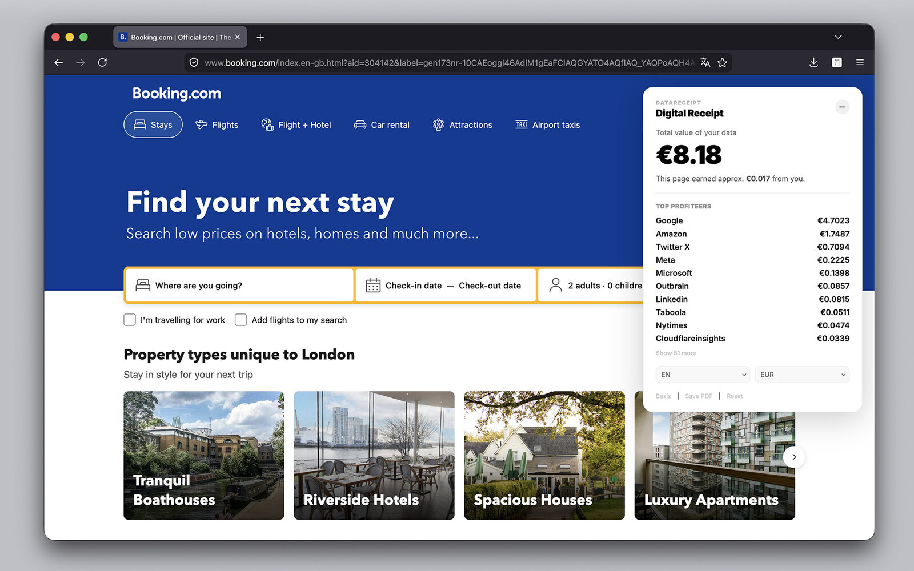
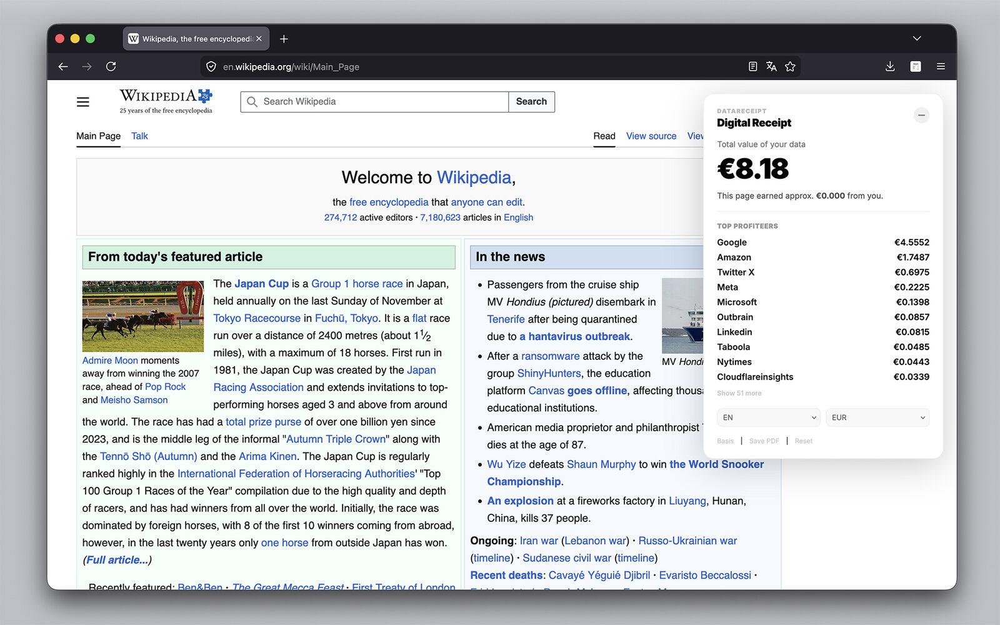

# DataReceipt


**DataReceipt makes the hidden trade in browsing data visible as a receipt.**

A browser extension that shows what companies earn by tracking your browsing. Third-party trackers are detected in real time, attributed to the company behind them, and turned into an estimate of the revenue that depends on tracking you — displayed as a live "Digital Receipt" overlay on any page you visit.

By [Jannik Bussmann](https://jannikbussmann.de/projects/datareceipt) · [datareceipt.org](https://datareceipt.org) · [Get it for Firefox](https://addons.mozilla.org/firefox/addon/datareceipt/)

<table>
  <tr>
    <td></td>
    <td></td>
    <td></td>
  </tr>
</table>

---

## How it works

1. The background script observes network requests via `webRequest` (it never blocks or modifies them).
2. Requests are matched by **hostname** against a curated list of ~60 tracking domains and endpoints (Google, Meta, Amazon, Criteo, The Trade Desk, …). Only **third-party** requests count — visiting google.com or amazon.de is not "being tracked".
3. Each company is counted **at most once per page load**, and its estimated revenue is added to your running total.
4. A "Digital Receipt" overlay shows the lifetime total, the value of the current page, and a ranking by company. It can be printed or saved as PDF as a receipt.

Everything happens locally. No data leaves the browser.

---

## Methodology

DataReceipt estimates the revenue companies earn **by tracking you on third-party websites** — not their total advertising revenue. Most ad revenue of Google, Meta or Amazon is earned on their own platforms (Search, YouTube, Instagram, amazon.com) and is deliberately excluded.

```
value per page = revenue × tracking dependence ÷ (internet users × page views per user per year × reach) × regional factor
```

- **Revenue:** latest annual reports (FY2025); TikTok and X are third-party forecasts.
- **Tracking dependence** — the share of revenue that would be lost without cross-site tracking, one concept for all companies: ads on other websites ~50%, search ads ~5%, social platforms ~9% (rough, evidence-based assumptions).
- **Denominator:** all page views worldwide on which the company's trackers appear (ITU internet users × estimated page views per user × estimated tracker reach).

For an average user, reach and page views only decide how the yearly amount is split across pages:

| Average user per year | Low | **Central** | High |
|---|---:|---:|---:|
| Europe | €2 | **€12** | €23 |
| US & Canada | $8 | **$38** | $123 |

**This is an order-of-magnitude estimate, not a measurement.** All inputs, sources, ranges, a plausibility check against market data, and the limitations are documented in **[docs/METHODOLOGY.md](docs/METHODOLOGY.md)**. Corrections with better sources are very welcome.

---

## Installation

### Requirements
- Node.js ≥ 20.9
- Yarn

### Chrome / Chromium

```bash
git clone https://github.com/jannikbussmann/datareceipt.git
cd datareceipt
yarn install
yarn build
```

1. Open `chrome://extensions`
2. Enable **Developer mode** (top right)
3. Click **Load unpacked** → select the `build/` directory

### Firefox

```bash
yarn build:firefox
```

1. Open `about:debugging#/runtime/this-firefox`
2. Click **Load Temporary Add-on** → select `build-firefox/manifest.json`

---

## Development

| Command | Description |
|---------|-------------|
| `yarn build` / `yarn build:firefox` | Development build → `build/` / `build-firefox/` |
| `yarn build:prod` / `yarn build:firefox:prod` | Production build |
| `yarn dev` / `yarn dev:firefox` | Watch mode |
| `yarn test` | Unit tests for tracker detection and the revenue model |
| `yarn format` / `yarn format:check` | Prettier |
| `yarn lint:firefox` | `web-ext lint` on the Firefox production build |
| `yarn package:chrome` / `yarn package:firefox` | Production build + zip → `dist/` |

After a rebuild, reload the extension (`chrome://extensions` or `about:debugging`).

---

## Project structure

```
src/
├── js/
│   ├── tracker-config.js      # Tracker list, third-party check, revenue model, regional factor
│   ├── background.js          # Request observation, per-page dedup (storage.session), lifetime stats
│   ├── content.js             # Content script entry
│   ├── receipt.js             # Printable receipt page
│   └── content/
│       ├── overlay.js         # Digital Receipt overlay (closed Shadow DOM)
│       ├── content.css        # Overlay styles (injected into the shadow root)
│       ├── i18n.js            # Translations (12 languages)
│       └── currency.js        # Currency formatting (16 currencies, fixed rates)
├── fonts/                     # Inter, loaded only inside the overlay
├── img/                       # Extension icons
├── receipt.html, receipt.css  # Receipt page
├── manifest.json              # Chrome (MV3)
└── manifest.firefox.json      # Firefox (MV3)
test/                          # node:test unit tests
docs/METHODOLOGY.md            # Revenue model: inputs, sources, ranges, limitations
```

---

## Permissions

| Permission | Why |
|-----------|-----|
| `webRequest` | Observe requests to detect trackers (read-only) |
| `storage` | Lifetime stats, settings, and per-page state |
| `<all_urls>` host permission | Observe requests and show the overlay on all sites |

No data ever leaves the browser. The overlay is rendered inside a closed Shadow DOM, so the websites you visit cannot read your stats.

---

## License

[MIT](LICENSE.md)
