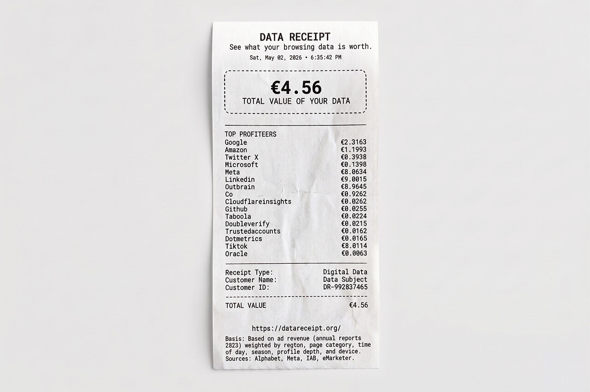

# DataReceipt


**DataReceipt makes the hidden trade in browsing data visible as a receipt.**

A browser extension that shows you what your browsing data is worth. Every tracker request is detected in real time, attributed to a corporate entity, and translated into an estimated monetary value — displayed as a live "Digital Receipt" overlay on any page you visit.

By [Jannik Bussmann](https://jannikbussmann.de/projects/datareceipt) · [datareceipt.org](https://datareceipt.org) · [Get it for Firefox](https://addons.mozilla.org/firefox/addon/datareceipt/)

<table>
  <tr>
    <td></td>
    <td></td>
    <td></td>
  </tr>
</table>

<p align="center">
  
</p>

---

## How it works

1. The background service worker intercepts all HTTP requests via `webRequest`
2. Each request is matched against a known tracker database (Google, Meta, Amazon, and 13 others)
3. On the first match per company per page load, a revenue estimate is added to your running total
4. The content script renders a "Digital Receipt" overlay with lifetime stats, a per-session note, and a breakdown by company
5. Stats persist across sessions via `chrome.storage.local` and can be exported as PDF

**Revenue methodology:** Annual advertising revenue (fiscal year 2023, official reports) ÷ estimated tracked users ÷ estimated tracked pages per user per year. Each company is counted at most once per page load — multiple requests from the same tracker on a single page do not inflate the estimate.

---

## Installation

### Requirements
- Node.js ≥ 16
- Yarn

### Chrome / Chromium

```bash
git clone https://github.com/jannikbussmann/datareceipt.git
cd datareceipt
yarn install
yarn build
```

1. Open `chrome://extensions`
2. Enable **Developer mode** (top right)
3. Click **Load unpacked** → select the `build/` directory

### Firefox

```bash
yarn build:firefox
```

1. Open `about:debugging#/runtime/this-firefox`
2. Click **Load Temporary Add-on** → select any file inside `build-firefox/`

To create a distributable `.zip` for [addons.mozilla.org](https://addons.mozilla.org):

```bash
yarn package:firefox   # → dist/firefox/*.zip
```

---

## Development

| Command | Description |
|---------|-------------|
| `yarn build` | Development build → `build/` (Chrome) |
| `yarn build:prod` | Production build → `build/` (Chrome) |
| `yarn build:firefox` | Development build → `build-firefox/` (Firefox) |
| `yarn build:firefox:prod` | Production build → `build-firefox/` (Firefox) |
| `yarn dev` | Watch mode → `build/` (Chrome) |
| `yarn dev:firefox` | Watch mode → `build-firefox/` (Firefox) |
| `yarn format` | Run Prettier over `src/` |
| `yarn lint:firefox` | Firefox compatibility lint via `web-ext` |
| `yarn package:firefox` | Build + package Firefox zip → `dist/firefox/` |

After any `yarn build` or `yarn dev` change, reload the extension in the browser:
- **Chrome:** `chrome://extensions` → click the reload icon
- **Firefox:** `about:debugging` → Reload

---

## Project structure

```
src/
├── js/
│   ├── tracker-config.js      # Tracker map, revenue weights & multipliers (single source of truth)
│   ├── background.js          # Service worker: tracker detection, deduplication, storage
│   ├── content.js             # Content script entry
│   └── content/
│       ├── overlay.js         # Digital Receipt overlay (closed Shadow DOM) + PDF export
│       ├── content.css        # Overlay styles (injected into the shadow root)
│       ├── fonts.css          # @font-face rules (must live in the page document)
│       ├── i18n.js            # Translations (12 languages)
│       └── currency.js        # Currency conversion & formatting (16 currencies)
├── fonts/                     # Inter (inlined as data URIs at build time)
├── img/
│   ├── icon-128.png
│   └── icon-34.png
├── manifest.json              # Chrome (MV3)
└── manifest.firefox.json      # Firefox (MV3, background.scripts)
```

---

## Revenue weights

Weights are defined in `src/js/tracker-config.js` and imported by `background.js`. To update a weight, change it in one place only.

The methodology and sources for each entity are documented inline in that file. In brief:

| Entity | Weight (USD/page) | Primary source |
|--------|-----------------:|----------------|
| Google | $0.00106 | Alphabet Annual Report 2023 |
| Meta | $0.00246 | Meta Annual Report 2023 |
| Amazon | $0.00535 | Amazon Annual Report 2023 |
| LinkedIn | $0.00767 | LinkedIn / Microsoft FY2023 (premium B2B CPM) |
| Microsoft | $0.00146 | Microsoft Annual Report FY2023 |
| TikTok | $0.00194 | ByteDance estimated revenue 2023 |
| The Trade Desk | $0.00102 | TTD Annual Report 2023 |
| Outbrain | $0.00057 | Outbrain Annual Report 2023 |
| Twitter / X | $0.00056 | Estimated X ad revenue 2023 |
| Taboola | $0.00049 | Taboola Annual Report 2023 |
| Salesforce | $0.00055 | Salesforce Marketing Cloud estimated 2023 |
| Reddit | $0.00100 | Reddit S-1 / estimated 2023 |
| Criteo | $0.00033 | Criteo Annual Report 2023 |
| Apple | $0.00020 | Minimal cross-site ad tracking; keywords are infra |
| Adobe | $0.00018 | Adobe Experience Cloud 2023; Audience Manager sunset |
| Oracle | $0.00005 | Oracle Advertising shut down June 2023 |
| Unknown | $0.00030 | Fallback for unrecognised trackers |

---

## Permissions

| Permission | Why |
|-----------|-----|
| `webRequest` | Intercept requests to detect trackers |
| `tabs` | Send messages to content scripts; detect page navigation for deduplication |
| `storage` | Persist lifetime stats and user settings |
| `<all_urls>` host permission | Content script and request monitoring on all sites |

No data ever leaves the browser. The overlay is rendered inside a closed Shadow DOM, so the websites you visit cannot read your stats.

---

## License

[MIT](LICENSE.md)
